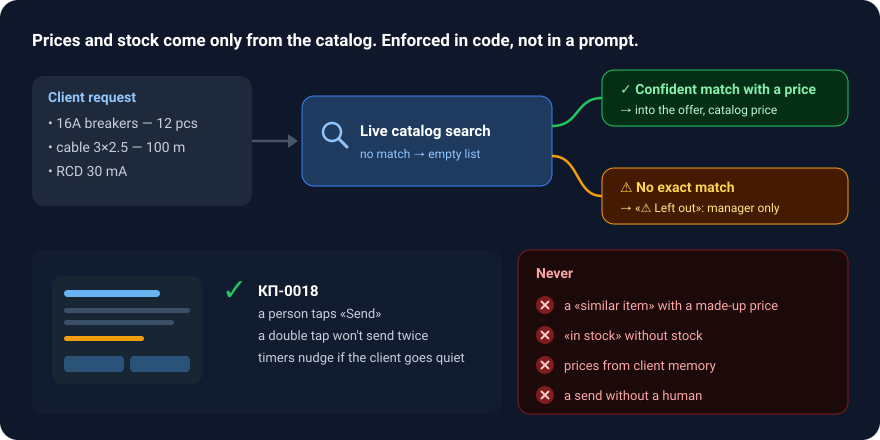
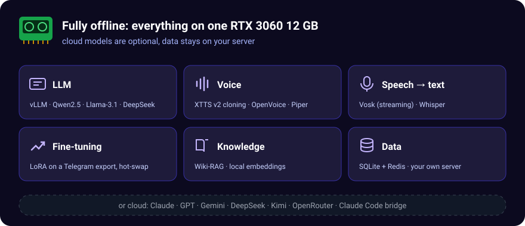
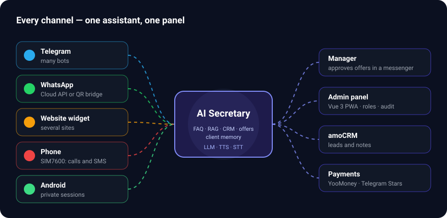

<div align="center">



[](https://github.com/ShaerWare/AI_Secretary_System/actions/workflows/ci.yml)
[](LICENSE)
[](https://python.org)
[](https://vuejs.org)
[](#quick-start)
[](https://github.com/ShaerWare/AI_Secretary_System/stargazers)

[**Live demo**](https://ai-sekretar24.ru/) · [Quick start](#quick-start) · [Wiki](https://github.com/ShaerWare/AI_Secretary_System/wiki) · [Telegram assistant](https://t.me/ai_sekretar24bot) · [Android APK](https://github.com/ShaerWare/AI_Secretary_System/releases/latest) · [**Русский**](README.ru.md)



<sub>The product UI speaks Russian, English and Kazakh. Example data is made up.</sub>

</div>

## Why it exists

Small sales teams live in messengers. A client writes «send me a quote for 12 breakers and 100 m of cable», and a manager spends 20 minutes digging through the catalog, copying SKUs and adding up totals. Generic AI chatbots are fast, but they make up prices and stock, so nobody lets them talk to clients alone.

AI Secretary does the boring part and leaves the decision with a person. Everything runs on your own server, with a local LLM if you want full privacy.

## Highlights

### 1. Offers drafted from the chat, approved in the messenger
- The assistant notices «send me a quote» in a WhatsApp dialogue by itself, with no commands.
- It extracts items and quantities, looks each one up in the **live catalog** and builds a draft offer.
- The manager gets a card in Telegram: what the client asked for, what was matched (with the client's own wording next to each line), what was left out, and the text for the client.
- **✅ Send · ✏️ Edit text · ❌ Cancel**: inline buttons in Telegram, or a numbered menu under the card on a service WhatsApp number (reply «1» to send). The messenger becomes the admin panel.
- Follow-up timers: «not approved yet», «client hasn't opened it», «opened and silent», «expires soon».

→ [How it works](docs/arch/outbound-kp.md) · [User guide](https://github.com/ShaerWare/AI_Secretary_System/wiki/KP)

### 2. An assistant that cannot lie about prices


- Product search returns an empty list when nothing matches, so the model has no gap to fill with a made-up item or price.
- «In stock» is shown only for confirmed stock. Supplier names and purchase prices are visible to managers only.
- **Client memory** carries a client card across dialogues (who they are, what they asked for, what they got), and code strips every price and stock line out of it.
- **A human approves every send.** A double tap won't send twice.

→ [Procurement & search](docs/arch/procurement.md) · [Client memory](docs/arch/client-memory.md)

### 3. A power-user web chat


<sub>Schematic of the chat screen.</sub>

- **Branching dialogues.** Editing a question or regenerating an answer starts a new branch. The branch tree panel shows every version and switches between them; nothing is lost.
- **Per-session system prompt** and **context files** (`.md`, `.csv`, `.json`, code…) that go into every request of that session.
- **Summarize branch → context file.** Compress a long thread into a summary and keep working from a clean branch.
- **Switch the model and knowledge base on the fly:** local Qwen/Llama, Claude, GPT, Gemini, DeepSeek… plus RAG collections per session.
- Context-window meter, streaming Markdown, voice input and voice replies, zen full-screen mode, export to `.md`/`.json`.
- **Share a chat** with a colleague; they see only the branch you shared.

→ [Chat guide](https://github.com/ShaerWare/AI_Secretary_System/wiki/Chat)

### 4. Runs fully offline


- **Local LLM** via vLLM (Qwen2.5-7B, Llama-3.1-8B, DeepSeek) on a single RTX 3060 12 GB.
- **Voice cloning** with XTTS v2 and OpenVoice, fast CPU voices with Piper, speech-to-text with Vosk (streaming) and Whisper.
- **LoRA fine-tuning** on an exported Telegram chat, with hot-swappable adapters.
- Cloud LLMs are optional. There's an [honest privacy table](docs/REFERENCE.ru.md#data-privacy-конфиденциальность-данных) on what a cloud provider gets to see.

### 5. Any LLM, including your Claude Code subscription
- Cloud providers: Gemini, OpenAI, Claude, DeepSeek, Kimi, OpenRouter, or anything OpenAI-compatible.
- **Claude Code CLI bridge.** Use Claude Code as an OpenAI-compatible backend, with an isolated `HOME` and per-user token tracking.
- An OpenAI-compatible API of its own (`/v1/chat/completions`), so it plugs into OpenWebUI and similar tools.

→ [LLM & prompts](docs/arch/llm-prompts.md)

### 6. Every channel from one panel


- **Telegram and WhatsApp bots**, as many instances as you need, each with its own model, prompt and voice. WhatsApp runs via the Meta Cloud API or a **self-hosted QR-linked bridge**.
- **Website chat widgets**, several per installation.
- **A real phone line.** A SIM7600 GSM modem lets the assistant answer calls and SMS.
- **Android app** with private sessions and ready-made assistants (marketer, developer, lawyer, accountant).
- Sales funnel, payments (YooMoney, Telegram Stars), amoCRM, Kanban with a Gantt roadmap, Wiki-RAG over Google Drive and RSS.
- Admin panel: Vue 3 PWA, RBAC with workspaces, audit log, 3 themes, **ru / en / kk**.

## Quick start

**CPU mode** (no GPU; uses a cloud LLM):

```bash
git clone https://github.com/ShaerWare/AI_Secretary_System
cd AI_Secretary_System
cp .env.docker.example .env        # set GEMINI_API_KEY, or add any provider later in the panel
docker compose -f docker-compose.yml -f docker-compose.cpu.yml up -d

# create your admin account (admin/admin in the panel always opens the offline demo)
docker exec ai-secretary python scripts/manage_users.py create owner 'a-strong-password' --role admin
```

Open <http://localhost:8002/admin> and sign in as `owner`.

**GPU mode** (local LLM, voice cloning): `docker compose up -d` with a local vLLM, or `docker compose -f docker-compose.yml -f docker-compose.full.yml up -d` for everything in containers. Requirements and details: [Installation](https://github.com/ShaerWare/AI_Secretary_System/wiki/Installation).

**Just looking?** The [live demo](https://ai-sekretar24.ru/) opens the admin panel with sample data (`admin` / `admin`).

## Architecture

```
              ┌──────────────── Orchestrator (FastAPI, :8002) ────────────────┐
 Telegram ──▶ │  chat · knowledge/RAG · CRM · КП/outbound · procurement · ... │ ◀── Vue 3 admin (PWA)
 WhatsApp ──▶ │  EventBus · TaskRegistry · SQLite + Redis · RBAC/workspaces   │ ◀── Android app
 Widget   ──▶ └───────┬────────────────────┬────────────────────┬──────────────┘
 Phone    ──▶         │                    │                    │
               LLM: vLLM / cloud /   TTS: XTTS v2 /       STT: Vosk /
               Claude Code bridge    OpenVoice / Piper    Whisper
```

The [interactive architecture map](docs/architecture/architecture-map.html) and the [architecture docs](docs/arch/) cover the rest.

## Documentation

| | |
|---|---|
| [Wiki](https://github.com/ShaerWare/AI_Secretary_System/wiki) | User guides for every admin section |
| [docs/arch/](docs/arch/) | Architecture by topic: backend, channels, КП, RAG, procurement, deployment |
| [docs/REFERENCE.ru.md](docs/REFERENCE.ru.md) | Full reference: API, environment variables, database, troubleshooting (RU) |
| [CHANGELOG.md](CHANGELOG.md) | What changed |

## Contributing

Issues and PRs are welcome, in English or Russian. Start with [CONTRIBUTING.md](CONTRIBUTING.md), look for [`good first issue`](https://github.com/ShaerWare/AI_Secretary_System/labels/good%20first%20issue), or ask in [Discussions](https://github.com/ShaerWare/AI_Secretary_System/discussions). Please report security problems privately, as described in [SECURITY.md](SECURITY.md).

If the project is useful to you, a ⭐ helps others find it.

## License

[MIT](LICENSE)
