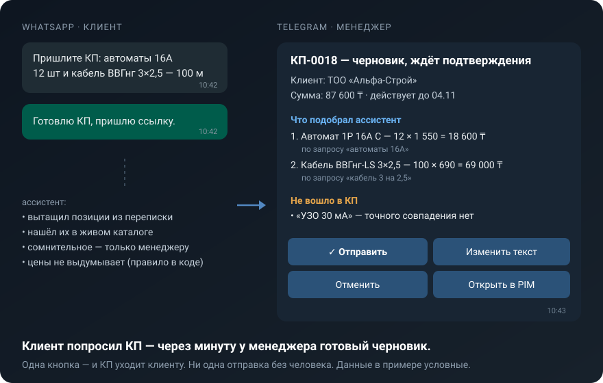
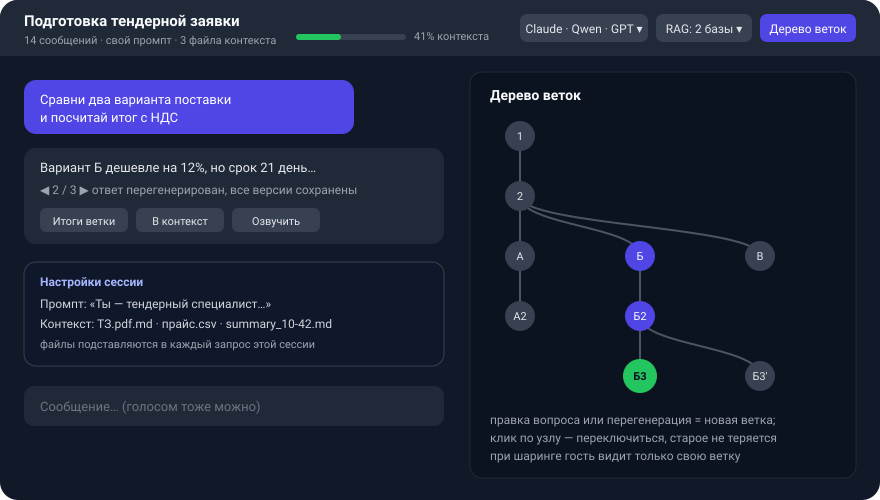

<div align="center">

# AI Secretary System · Секретарь24

**Self-hosted ИИ-секретарь и менеджер продаж с открытым кодом.**<br>
Сам собирает коммерческое предложение из переписки в WhatsApp, а менеджер утверждает его одной кнопкой в Telegram.<br>
Не выдумывает цены: это правило зашито в код, а не в промпт.

[](https://github.com/ShaerWare/AI_Secretary_System/actions/workflows/ci.yml)
[](LICENSE)
[](https://python.org)
[](https://vuejs.org)
[](#быстрый-старт)
[](https://github.com/ShaerWare/AI_Secretary_System/stargazers)

[**Демо**](https://ai-sekretar24.ru/) · [Быстрый старт](#быстрый-старт) · [Wiki](https://github.com/ShaerWare/AI_Secretary_System/wiki) · [Ассистент в Telegram](https://t.me/ai_sekretar24bot) · [Android APK](https://github.com/ShaerWare/AI_Secretary_System/releases/latest) · [**English**](README.md)



</div>

## Зачем

Продажи в малом бизнесе живут в мессенджерах. Клиент пишет «пришлите КП на 12 автоматов и 100 м кабеля», и менеджер 20 минут ищет артикулы и считает суммы. Обычные ИИ-боты отвечают быстро, но придумывают цены и наличие, поэтому им не доверяют говорить с клиентом в одиночку.

AI Secretary делает рутину сам, а решение оставляет человеку. Всё работает на вашем сервере, а для полной приватности можно взять локальную модель.

## Главное

### 1. КП из переписки и утверждение прямо в мессенджере
- Ассистент сам замечает в диалоге WhatsApp просьбу «пришлите КП», без всяких команд.
- Вытаскивает позиции и количества, ищет каждую в **живом каталоге** и собирает черновик.
- Менеджеру приходит карточка в Telegram: что просил клиент, что подобрано (рядом с каждой позицией исходная формулировка клиента), что не вошло, и готовый текст для клиента.
- **✅ Отправить · ✏️ Изменить текст · ❌ Отменить**: кнопками в Telegram или цифрой из меню под карточкой в служебном WhatsApp. Мессенджер работает как админка.
- Таймеры доводят сделку: «не утверждено», «клиент не открыл», «открыл и молчит», «скоро истекает».

→ [Как устроено](docs/arch/outbound-kp.md) · [Руководство](https://github.com/ShaerWare/AI_Secretary_System/wiki/KP)

### 2. Ассистент, который не врёт про цены
- Поиск по каталогу возвращает пустой список, если ничего не нашлось, поэтому модели нечем «додумать» товар или цену.
- «В наличии» пишется только при подтверждённом остатке. Поставщики и закупочные цены видны только менеджерам.
- **Память о клиенте** между диалогами: кто он, что спрашивал, что получил. Строки с ценами и остатками код из неё вырезает.
- **Каждую отправку утверждает человек.** Двойное нажатие не отправит КП дважды.

→ [Поиск и закупки](docs/arch/procurement.md) · [Память о клиенте](docs/arch/client-memory.md)

### 3. Мегаудобный веб-чат


<sub>Схема экрана чата.</sub>

- **Ветвление диалогов.** Правка вопроса или перегенерация ответа создаёт новую ветку. Панель «Дерево веток» показывает все версии и переключает между ними, ничего не теряется.
- **Свой системный промпт на сессию** и **файлы контекста** (`.md`, `.csv`, `.json`, код…), которые уходят в каждый запрос этой сессии.
- **«Итоги ветки» → файл контекста.** Длинный тред сжимается в выжимку, дальше работа идёт с чистой ветки.
- **Модель и база знаний переключаются на лету:** локальные Qwen/Llama, Claude, GPT, Gemini, DeepSeek… и RAG-коллекции на каждую сессию.
- Шкала заполнения контекста, стриминг Markdown, голосовой ввод и озвучка ответов, zen-режим на весь экран, экспорт в `.md`/`.json`.
- **Можно поделиться чатом** с коллегой: он увидит только ту ветку, которой вы поделились.

→ [Руководство по чату](https://github.com/ShaerWare/AI_Secretary_System/wiki/Chat)

### 4. Работает полностью офлайн
- **Локальная LLM** через vLLM (Qwen2.5-7B, Llama-3.1-8B, DeepSeek) на одной RTX 3060 12 ГБ.
- **Клонирование голоса** на XTTS v2 и OpenVoice, быстрые голоса Piper на CPU, распознавание речи на Vosk (стриминг) и Whisper.
- **LoRA-дообучение** на экспорте Telegram-чата, адаптеры меняются без перезапуска.
- Облачные модели не обязательны. Есть [честная таблица](docs/REFERENCE.ru.md#data-privacy-конфиденциальность-данных) о том, что увидит облачный провайдер.

### 5. Любая модель, включая подписку Claude Code
- Облачные провайдеры: Gemini, OpenAI, Claude, DeepSeek, Kimi, OpenRouter и любой OpenAI-совместимый.
- **Мост к Claude Code CLI.** Claude Code работает как OpenAI-совместимый бэкенд, с изолированным `HOME` и учётом токенов по пользователям.
- Свой OpenAI-совместимый API (`/v1/chat/completions`), так что подключается к OpenWebUI и похожим инструментам.

→ [LLM и промпты](docs/arch/llm-prompts.md)

### 6. Все каналы из одной панели
- **Боты Telegram и WhatsApp**, сколько угодно экземпляров, у каждого своя модель, промпт и голос. WhatsApp работает через Meta Cloud API или **свой QR-мост**.
- **Чат-виджеты для сайтов**, несколько на одну установку.
- **Настоящая телефонная линия.** GSM-модем SIM7600 позволяет ассистенту отвечать на звонки и SMS.
- **Android-приложение** с приватными сессиями и готовыми ассистентами (маркетолог, программист, юрист, бухгалтер).
- Воронка продаж, оплата (ЮMoney, Telegram Stars), amoCRM, Канбан с диаграммой Ганта, Wiki-RAG по Google Drive и RSS.
- Админ-панель: Vue 3 PWA, роли и рабочие пространства, журнал аудита, 3 темы, **ru / en / kk**.

## Быстрый старт

**CPU-режим** (без видеокарты, с облачной моделью):

```bash
git clone https://github.com/ShaerWare/AI_Secretary_System
cd AI_Secretary_System
cp .env.docker.example .env        # впишите GEMINI_API_KEY или добавьте провайдера позже в панели
docker compose -f docker-compose.yml -f docker-compose.cpu.yml up -d

# создайте своего администратора (admin/admin в панели всегда открывает офлайн-демо)
docker exec ai-secretary python scripts/manage_users.py create owner 'надёжный-пароль' --role admin
```

Откройте <http://localhost:8002/admin> и войдите как `owner`.

**GPU-режим** (локальная модель, клонирование голоса): `docker compose up -d` вместе с локальным vLLM или `docker compose -f docker-compose.yml -f docker-compose.full.yml up -d`, чтобы всё работало в контейнерах. Требования и подробности: [Установка](https://github.com/ShaerWare/AI_Secretary_System/wiki/Installation).

**Просто посмотреть?** [Демо](https://ai-sekretar24.ru/) открывает админку на тестовых данных (`admin` / `admin`).

## Архитектура

```
              ┌──────────────── Orchestrator (FastAPI, :8002) ────────────────┐
 Telegram ──▶ │  chat · knowledge/RAG · CRM · КП/outbound · procurement · ... │ ◀── Vue 3 админка (PWA)
 WhatsApp ──▶ │  EventBus · TaskRegistry · SQLite + Redis · RBAC/workspaces   │ ◀── Android-приложение
 Виджет   ──▶ └───────┬────────────────────┬────────────────────┬──────────────┘
 Телефон  ──▶         │                    │                    │
               LLM: vLLM / облако /  TTS: XTTS v2 /       STT: Vosk /
               мост Claude Code      OpenVoice / Piper    Whisper
```

Подробнее: [интерактивная карта архитектуры](docs/architecture/architecture-map.html) и [документация по архитектуре](docs/arch/).

## Документация

| | |
|---|---|
| [Wiki](https://github.com/ShaerWare/AI_Secretary_System/wiki) | Руководства по каждому разделу админки |
| [docs/arch/](docs/arch/) | Архитектура по темам: бэкенд, каналы, КП, RAG, закупки, деплой |
| [docs/REFERENCE.ru.md](docs/REFERENCE.ru.md) | Полный справочник: API, переменные окружения, БД, troubleshooting |
| [CHANGELOG.md](CHANGELOG.md) | История изменений |

## Участие

Issues и PR принимаются на русском и английском. Начните с [CONTRIBUTING.md](CONTRIBUTING.md), загляните в задачи с меткой [`good first issue`](https://github.com/ShaerWare/AI_Secretary_System/labels/good%20first%20issue) или задайте вопрос в [Discussions](https://github.com/ShaerWare/AI_Secretary_System/discussions). Об уязвимостях сообщайте приватно, как описано в [SECURITY.md](SECURITY.md).

Если проект вам полезен, поставьте ⭐: так его проще найти другим.

## Лицензия

[MIT](LICENSE)
