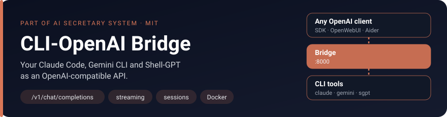

# CLI-OpenAI Bridge

[](LICENSE)
[](https://www.python.org/downloads/)
[](https://fastapi.tiangolo.com)
[](https://github.com/ShaerWare/AI_Secretary_System)

> **Transform CLI AI tools into a unified OpenAI-compatible API**

A versatile bridge that exposes CLI versions of AI models (Claude Code, Gemini CLI, Shell-GPT) as OpenAI-compatible REST API services. Use your favorite AI coding assistants through any OpenAI-compatible client.

It powers the Claude Code backend of [AI Secretary System](https://github.com/ShaerWare/AI_Secretary_System), an open-source self-hosted AI sales assistant, and works just as well on its own.

> **Mirror notice.** This repository is an automatic, read-only mirror of [`services/bridge`](https://github.com/ShaerWare/AI_Secretary_System/tree/main/services/bridge) in AI Secretary System. Stars are welcome here; please open issues and pull requests [in the main repository](https://github.com/ShaerWare/AI_Secretary_System/issues).

---

## Table of Contents

- [Use Cases](#use-cases)
- [Responsible Use](#responsible-use)
- [Features](#features)
- [Supported Providers](#supported-providers)
- [Quick Start](#quick-start)
- [Docker Deployment](#docker-deployment)
- [API Reference](#api-reference)
- [Configuration](#configuration)
- [Project Structure](#project-structure)
- [Troubleshooting](#troubleshooting)
- [Manual Deployment](#manual-deployment-without-git)
- [Systemd Service](#systemd-service-linux)
- [License](#license)

---

## Use Cases

| Use Case | Description |
|----------|-------------|
| **Aider / Cursor / Continue** | Use Claude Code or Gemini CLI as backend for coding assistants |
| **Custom Applications** | Build apps using OpenAI SDK that work with any CLI provider |
| **Reuse a CLI you already have** | Point your own tools at the CLI you are already signed in to — see [Responsible Use](#responsible-use) |
| **Unified Interface** | Single API for multiple AI providers |
| **Self-Hosted** | Run your own AI API server with full control |

---

## Responsible Use

The bridge runs the official CLIs exactly as you would in a terminal, under whatever account they are signed in to. Each provider's terms apply to that account: personal subscriptions are generally meant for the subscriber's own use. Serving other people or running a product on top of it is a job for API keys (Claude Code and Gemini CLI both accept them; see `ANTHROPIC_API_KEY` / `GEMINI_API_KEY` in their docs). Set `BRIDGE_API_KEY` and never expose the bridge to the internet without it.

---

## Features

### Core
- **Multi-Provider Support** - Claude Code, Gemini CLI, Shell-GPT
- **OpenAI-Compatible API** - Drop-in replacement for OpenAI endpoints
- **Streaming Support** - Real-time responses via Server-Sent Events
- **Function Calling** - Full OpenAI-compatible tools/functions API

### Advanced
- **Multi-Turn Conversations** - Session management with `conversation_id`
- **Thinking/Reasoning** - Extended thinking modes for complex tasks
- **Permission Levels** - Control CLI tool access (chat, readonly, edit, full)
- **Request Queue** - Per-provider concurrency limits

### Operations
- **Web Dashboard** - Built-in testing console and metrics
- **Cost Tracking** - Per-request and aggregated cost estimates
- **Token Metrics** - Detailed usage statistics
- **Rate Limiting** - Optional request throttling
- **Response Caching** - Cache repeated requests
- **Graceful Shutdown** - Queue draining and metrics persistence

---

## Supported Providers

| Provider | CLI Tool | Models |
|----------|----------|--------|
| Claude | [Claude Code](https://docs.anthropic.com/en/docs/claude-code) | sonnet, opus, haiku, claude-opus-4-5-*, claude-sonnet-4-5-*, claude-haiku-4-5-* |
| Gemini | [Gemini CLI](https://github.com/google-gemini/gemini-cli) | gemini-3-flash-preview, gemini-3-pro-preview, gemini-2.5-pro, gemini-2.5-flash |
| GPT | [Shell-GPT](https://github.com/TheR1D/shell_gpt) | gpt-4o, gpt-4o-mini, o1, o3-mini |

**Note:** Model lists are configurable via `CLAUDE_MODELS`, `GEMINI_MODELS`, `GPT_MODELS` in `.env`

---

## Quick Start

### Prerequisites

- Python 3.10+
- At least one CLI tool installed and authenticated:
  - [Claude Code](https://docs.anthropic.com/en/docs/claude-code) - `npm install -g @anthropic-ai/claude-code`
  - [Gemini CLI](https://github.com/google-gemini/gemini-cli) - `npm install -g @google/gemini-cli`
  - [Shell-GPT](https://github.com/TheR1D/shell_gpt) - `pip install shell-gpt`

### Installation

```bash
# Clone and install
git clone https://github.com/ShaerWare/cli-openai-bridge.git
cd cli-openai-bridge
python3 -m venv .venv
source .venv/bin/activate
pip install -r requirements.txt

# Configure (optional)
cp .env.example .env
nano .env

# Run
python -m src.server.main
```

### Verify

- API: http://localhost:8000
- Dashboard: http://localhost:8000/dashboard
- Health: http://localhost:8000/health

### Quick Test

```bash
curl http://localhost:8000/v1/chat/completions \
  -H "Content-Type: application/json" \
  -d '{"model": "sonnet", "messages": [{"role": "user", "content": "Hello!"}]}'
```

---

## Docker Deployment

The image ships Python, Claude Code and Gemini CLI (Shell-GPT is optional, see the `Dockerfile`).

```bash
# Build
docker build -t cli-openai-bridge .

# Run
docker run -d \
  --name cli-openai-bridge \
  -p 8000:8000 \
  -v ~/.cli-openai-bridge:/root/.cli-openai-bridge \
  -e BRIDGE_API_KEY=your-secret-key \
  -e CLAUDE_CODE_OAUTH_TOKEN=... \
  cli-openai-bridge
```

**Authenticating the CLIs inside the container**, pick one per tool:

- Claude Code: pass a long-lived token from `claude setup-token` as `CLAUDE_CODE_OAUTH_TOKEN`, or an API key as `ANTHROPIC_API_KEY`, or log in interactively: `docker exec -it cli-openai-bridge claude`.
- Gemini CLI: pass `GEMINI_API_KEY`, or run `docker exec -it cli-openai-bridge gemini` once and follow the login prompt.

To keep an interactive login across restarts, also mount `~/.claude` (and `~/.gemini`) into `/root`.

---

## API Reference

### Endpoints

| Endpoint | Method | Description |
|----------|--------|-------------|
| `/v1/chat/completions` | POST | Chat completions (OpenAI-compatible) |
| `/v1/models` | GET | List available models |
| `/health` | GET | Health check with queue stats |
| `/metrics` | GET | Usage metrics and costs |
| `/dashboard` | GET | Web testing console |

### Basic Request

```bash
curl http://localhost:8000/v1/chat/completions \
  -H "Content-Type: application/json" \
  -d '{
    "model": "sonnet",
    "messages": [{"role": "user", "content": "Hello!"}],
    "stream": true
  }'
```

### Response Format

```json
{
  "id": "chatcmpl-abc123",
  "object": "chat.completion",
  "model": "sonnet",
  "choices": [{
    "message": {
      "role": "assistant",
      "content": "Hello! How can I help you today?"
    },
    "finish_reason": "stop"
  }],
  "usage": {"prompt_tokens": 10, "completion_tokens": 15, "total_tokens": 25},
  "provider": "claude",
  "conversation_id": "conv-abc123def456"
}
```

### Multi-Turn Conversations

Use `conversation_id` from the response to continue conversations:

```bash
curl http://localhost:8000/v1/chat/completions \
  -H "Content-Type: application/json" \
  -d '{
    "model": "sonnet",
    "messages": [{"role": "user", "content": "What did I just ask?"}],
    "conversation_id": "conv-abc123def456"
  }'
```

### Function Calling (Tools)

```bash
curl http://localhost:8000/v1/chat/completions \
  -H "Content-Type: application/json" \
  -d '{
    "model": "sonnet",
    "messages": [{"role": "user", "content": "What is the weather in London?"}],
    "tools": [{
      "type": "function",
      "function": {
        "name": "get_weather",
        "description": "Get weather for a location",
        "parameters": {
          "type": "object",
          "properties": {
            "location": {"type": "string", "description": "City name"}
          },
          "required": ["location"]
        }
      }
    }]
  }'
```

<details>
<summary><b>Tool Call Response</b></summary>

```json
{
  "choices": [{
    "message": {
      "role": "assistant",
      "content": null,
      "tool_calls": [{
        "id": "call_abc123",
        "type": "function",
        "function": {
          "name": "get_weather",
          "arguments": "{\"location\": \"London\"}"
        }
      }]
    },
    "finish_reason": "tool_calls"
  }]
}
```
</details>

<details>
<summary><b>Sending Tool Results</b></summary>

```bash
curl http://localhost:8000/v1/chat/completions \
  -H "Content-Type: application/json" \
  -d '{
    "model": "sonnet",
    "messages": [
      {"role": "user", "content": "What is the weather in London?"},
      {"role": "assistant", "content": null, "tool_calls": [{"id": "call_abc123", "type": "function", "function": {"name": "get_weather", "arguments": "{\"location\": \"London\"}"}}]},
      {"role": "tool", "tool_call_id": "call_abc123", "content": "15C, cloudy with light rain"}
    ],
    "tools": [...]
  }'
```
</details>

**Tool choice options:** `"auto"` (default), `"none"`, `"required"`, or specific function

---

## Configuration

All settings via environment variables or `.env` file.

### Server

| Variable | Default | Description |
|----------|---------|-------------|
| `BRIDGE_HOST` | `0.0.0.0` | Server host |
| `BRIDGE_PORT` | `8000` | Server port |
| `BRIDGE_API_KEY` | - | API key (enables auth) |

**Authentication:** When `BRIDGE_API_KEY` is set:
- API: `Authorization: Bearer <key>`
- Dashboard: HTTP Basic Auth (any username, key as password)

### CLI Paths & Timeouts

| Variable | Default | Description |
|----------|---------|-------------|
| `CLAUDE_CLI_PATH` | `claude` | Claude Code CLI path |
| `GEMINI_CLI_PATH` | `gemini` | Gemini CLI path |
| `GPT_CLI_PATH` | `sgpt` | Shell-GPT path |
| `CLI_TIMEOUT` | `300` | Default timeout (seconds) |
| `STREAM_TIMEOUT` | `600` | Streaming timeout |

### Permission Levels

| Variable | Default |
|----------|---------|
| `CLAUDE_PERMISSION_LEVEL` | `full` |
| `GEMINI_PERMISSION_LEVEL` | `full` |
| `GPT_PERMISSION_LEVEL` | `full` |

| Level | Description |
|-------|-------------|
| `chat` | **No local operations** - pure LLM text only. For Aider/Cursor. |
| `readonly` | Read operations only (view files, search) |
| `edit` | Read + file edits, no shell/web |
| `full` | All operations (default) |

### Queue & Rate Limiting

| Variable | Default | Description |
|----------|---------|-------------|
| `QUEUE_ENABLED` | `true` | Enable request queue |
| `QUEUE_MAX_SIZE` | `50` | Max pending per provider |
| `QUEUE_CLAUDE_CONCURRENT` | `2` | Claude concurrency |
| `QUEUE_GEMINI_CONCURRENT` | `3` | Gemini concurrency |
| `RATE_LIMIT_ENABLED` | `false` | Enable rate limiting |
| `RATE_LIMIT_REQUESTS` | `60` | Requests per window |

### Caching

| Variable | Default | Description |
|----------|---------|-------------|
| `CACHE_ENABLED` | `false` | Enable response cache |
| `CACHE_TTL` | `3600` | Cache TTL (seconds) |

---

## Project Structure

```
cli-openai-bridge/
├── src/
│   ├── providers/          # CLI provider implementations
│   │   ├── claude/         # Claude Code
│   │   ├── gemini/         # Gemini CLI
│   │   └── gpt/            # Shell-GPT
│   ├── server/             # FastAPI server
│   │   ├── routes/         # API endpoints
│   │   ├── middleware/     # Auth, rate limiting
│   │   └── static/         # Dashboard assets
│   ├── models/             # Pydantic models
│   ├── utils/              # Metrics, cache, tokens
│   └── config/             # Settings
├── docs/                   # Documentation
├── requirements.txt
└── README.md
```

### Data Directory

Runtime data stored in `~/.cli-openai-bridge/`:

| Path | Description |
|------|-------------|
| `metrics.json` | Persisted usage statistics |
| `sandbox/` | CLI working directory & uploads |

---

## Troubleshooting

### Common Issues

<details>
<summary><b>CLI not found</b></summary>

```
Error: Claude CLI failed: command not found
```

**Solution:** Ensure CLI is installed and in PATH:
```bash
which claude  # Should show path
claude --version  # Should show version
```

Or set explicit path in `.env`:
```
CLAUDE_CLI_PATH=/usr/local/bin/claude
```
</details>

<details>
<summary><b>Finding CLI paths</b></summary>

If CLIs are installed but not found, locate them with:

```bash
# Linux/macOS
which claude gemini sgpt
# Or search common locations
ls -la $(npm root -g)/@anthropic-ai/claude-code/cli.js 2>/dev/null
ls -la $(npm root -g)/@anthropic-ai/gemini-cli/cli.js 2>/dev/null

# For NVM users (node-based CLIs)
ls ~/.nvm/versions/node/*/bin/{claude,gemini} 2>/dev/null

# Windows (PowerShell)
Get-Command claude, gemini, sgpt -ErrorAction SilentlyContinue | Select-Object Source
```

Then set paths in `.env`:
```
CLAUDE_CLI_PATH=/home/user/.nvm/versions/node/v20.10.0/bin/claude
GEMINI_CLI_PATH=/home/user/.nvm/versions/node/v20.10.0/bin/gemini
GPT_CLI_PATH=/home/user/.local/bin/sgpt
```

**Note:** For systemd services, use a wrapper script that sources your shell environment (see [Systemd Service](#systemd-service-linux)).
</details>

<details>
<summary><b>Authentication errors</b></summary>

```
Error: Not authenticated
```

**Solution:** Run CLI authentication:
```bash
claude auth login
gemini auth login
```
</details>

<details>
<summary><b>Timeout errors</b></summary>

```
Error: Request timed out
```

**Solution:** Increase timeout in `.env`:
```
CLI_TIMEOUT=600
STREAM_TIMEOUT=900
```
</details>

<details>
<summary><b>Queue full errors</b></summary>

```
Error: Server busy, request queue full
```

**Solution:** Increase queue size or concurrency:
```
QUEUE_MAX_SIZE=100
QUEUE_CLAUDE_CONCURRENT=4
```
</details>

<details>
<summary><b>Tool calls showing as raw text</b></summary>

When using tools API, ensure you're on the latest version. Tool call blocks are filtered from output as of v1.0.

</details>

### Debug Mode

Enable debug logging:
```
BRIDGE_DEBUG=true
LOG_LEVEL=DEBUG
```

---

## Additional Documentation

- [Architecture Overview](docs/ARCHITECTURE.md)
- [Provider Details](docs/PROVIDERS.md)
- [Development Guide](docs/DEVELOPMENT.md)
- [Reverse Proxy Setup](docs/REVERSE-PROXY.md)

---

## Manual Deployment (without Git)

<details>
<summary><b>rsync method</b></summary>

```bash
rsync -avz --exclude='.git' --exclude='.venv*' --exclude='__pycache__' \
  --exclude='.idea' --exclude='.claude' --exclude='.env' --exclude='*.pyc' \
  ./ user@remote:/opt/cli-openai-bridge/
```
</details>

<details>
<summary><b>scp method</b></summary>

```bash
tar -czf bridge.tar.gz --exclude='.git' --exclude='.venv*' --exclude='__pycache__' \
  src/ requirements.txt .env.example start.sh start-wsl.sh README.md

scp bridge.tar.gz user@remote:/opt/
ssh user@remote "cd /opt && mkdir -p cli-openai-bridge && tar -xzf bridge.tar.gz -C cli-openai-bridge"
```
</details>

<details>
<summary><b>On remote server</b></summary>

```bash
cd /opt/cli-openai-bridge
python3 -m venv .venv
source .venv/bin/activate
pip install -r requirements.txt
cp .env.example .env
nano .env  # Configure
./start.sh
```
</details>

---

## Systemd Service (Linux)

<details>
<summary><b>Create systemd service for auto-start</b></summary>

### 1. Create wrapper script

Systemd doesn't load shell profiles, so create a wrapper to source your environment (NVM, etc.):

```bash
nano ~/cli-openai-bridge/start-service.sh
```

```bash
#!/bin/bash
source ~/.bashrc
source ~/.nvm/nvm.sh  # if using NVM for node-based CLIs
./start.sh
```

```bash
chmod +x ~/cli-openai-bridge/start-service.sh
```

### 2. Create service file

```bash
sudo nano /etc/systemd/system/cli-openai-bridge.service
```

```ini
[Unit]
Description=CLI-OpenAI Bridge API Server
After=network.target

[Service]
Type=simple
User=your-username
Group=your-username
WorkingDirectory=/home/your-username/cli-openai-bridge
ExecStart=/home/your-username/cli-openai-bridge/start-service.sh
Restart=always
RestartSec=5
StandardOutput=journal
StandardError=journal

[Install]
WantedBy=multi-user.target
```

### 3. Enable and start

```bash
# Reload systemd
sudo systemctl daemon-reload

# Enable auto-start on boot
sudo systemctl enable cli-openai-bridge

# Start the service
sudo systemctl start cli-openai-bridge

# Check status
sudo systemctl status cli-openai-bridge
```

### 4. View logs

```bash
# Follow logs in real-time
sudo journalctl -u cli-openai-bridge -f

# View last 100 lines
sudo journalctl -u cli-openai-bridge -n 100

# View logs since last boot
sudo journalctl -u cli-openai-bridge -b
```

### 5. Management commands

```bash
sudo systemctl stop cli-openai-bridge     # Stop
sudo systemctl restart cli-openai-bridge  # Restart
sudo systemctl disable cli-openai-bridge  # Disable auto-start
```

</details>

<details>
<summary><b>Alternative: User service (no sudo)</b></summary>

For running as a user service without root:

```bash
mkdir -p ~/.config/systemd/user/

cat > ~/.config/systemd/user/cli-openai-bridge.service << 'EOF'
[Unit]
Description=CLI-OpenAI Bridge API Server
After=network.target

[Service]
Type=simple
WorkingDirectory=%h/cli-openai-bridge
ExecStart=%h/cli-openai-bridge/.venv/bin/python -m src.server.main
Restart=on-failure
RestartSec=5

[Install]
WantedBy=default.target
EOF

# Enable and start
systemctl --user daemon-reload
systemctl --user enable cli-openai-bridge
systemctl --user start cli-openai-bridge

# Enable lingering (keeps service running after logout)
loginctl enable-linger $USER
```

</details>

---

## License

MIT
