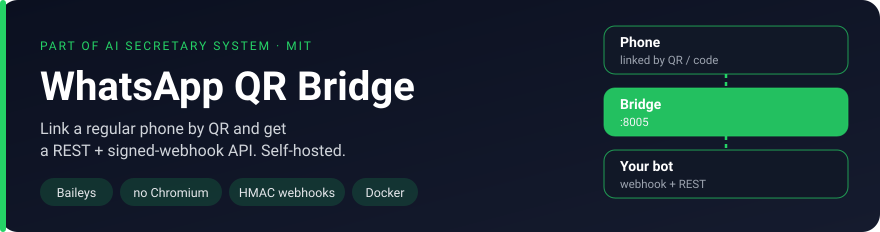

# WhatsApp QR Bridge

[](LICENSE)
[](https://nodejs.org)
[](https://github.com/WhiskeySockets/Baileys)
[](https://github.com/ShaerWare/AI_Secretary_System)

Links a regular phone (WhatsApp or WhatsApp Business app) over the multi-device
protocol via QR or a pairing code and exposes it as a small REST + webhook API.
This is the role Wazzup / Green API / Radist play, except it runs on your own
host: no third-party contract and no message content leaving the server.

Built on [Baileys](https://github.com/WhiskeySockets/Baileys) (WebSocket, no
Chromium, no Puppeteer). It is the WhatsApp transport of
[AI Secretary System](https://github.com/ShaerWare/AI_Secretary_System), an
open-source self-hosted AI sales assistant, and works with any bot that can
receive a webhook.

> **Mirror notice.** This repository is an automatic, read-only mirror of
> [`services/whatsapp-bridge`](https://github.com/ShaerWare/AI_Secretary_System/tree/main/services/whatsapp-bridge)
> in AI Secretary System. Stars are welcome here; please open issues and pull
> requests [in the main repository](https://github.com/ShaerWare/AI_Secretary_System/issues).

```
phone ──QR──► whatsapp-bridge (:8005) ──signed webhook──► your bot
                    ▲                                        │
                    └─────────── REST: send / read ──────────┘
```

## Run

```bash
npm install
WHATSAPP_BRIDGE_TOKEN=$(openssl rand -hex 24) npm start
```

Docker:

```bash
docker build -t whatsapp-qr-bridge .
docker run -d --name wa-bridge -p 8005:8005 \
  -e WHATSAPP_BRIDGE_TOKEN=<token> \
  -v wa-bridge-data:/data \
  whatsapp-qr-bridge
```

The `/data` volume holds linked-device credentials. **Without it every restart
demands a fresh QR scan.**

### Environment

| Variable | Default | Meaning |
|---|---|---|
| `WHATSAPP_BRIDGE_TOKEN` | — | Shared secret, **required**. Also signs webhooks. |
| `WHATSAPP_BRIDGE_PORT` | `8005` | Listen port. |
| `WHATSAPP_BRIDGE_HOST` | `127.0.0.1` | Bind address (`0.0.0.0` in Docker). |
| `WHATSAPP_BRIDGE_DATA` | `./data` | Credentials directory, one subdir per session. |
| `LOG_LEVEL` | `info` | pino level. |

## Linking a phone

**Standalone**, over the API:

```bash
T=<token>
# open a session that will deliver messages to your webhook
curl -X POST localhost:8005/sessions/support/start -H "X-Bridge-Token: $T" \
  -H 'Content-Type: application/json' -d '{"webhook_url": "http://127.0.0.1:9000/wa"}'
# poll the state: while it is "qr", the response carries a QR data-URL
curl localhost:8005/sessions/support -H "X-Bridge-Token: $T"
```

Scan the QR from *WhatsApp → Settings → Linked devices*. No camera at hand?
Start with `{"webhook_url": "...", "pairing_phone": "79001234567"}` instead:
the state becomes `pairing` with an 8-character `pairing_code` to type on that
phone. Credentials persist, so the session re-attaches silently after a restart.

**Inside AI Secretary System**: admin panel → WhatsApp → instance with
`provider = bridge` → «Подключить телефон». Set the same token in its `.env`:

```bash
WHATSAPP_BRIDGE_URL=http://127.0.0.1:8005
WHATSAPP_BRIDGE_TOKEN=<same token>
WHATSAPP_BRIDGE_CALLBACK_HOST=127.0.0.1   # where the bridge reaches the bot
```

## API

Every route except `/health` requires `X-Bridge-Token` (or `Authorization:
Bearer`). One session id == one WhatsApp instance id.

| Method | Path | Purpose |
|---|---|---|
| `GET` | `/health` | Liveness + all session states. |
| `GET` | `/sessions` | List sessions. |
| `POST` | `/sessions/:id/start` | Open the socket. Body: `{webhook_url, force, pairing_phone}`; `force` drops revoked credentials, `pairing_phone` links by code instead of QR. |
| `GET` | `/sessions/:id` | State: `idle`/`starting`/`qr`/`pairing`/`connected`/`disconnected`/`logged_out` (+ `qr` data-URL while pairing). |
| `POST` | `/sessions/:id/stop` | Close the socket, keep credentials. |
| `POST` | `/sessions/:id/logout` | Unlink the phone and wipe credentials. |
| `POST` | `/sessions/:id/messages` | Send. Body: `{to, type, text \| url, caption, filename, mimetype, voice}`. |
| `POST` | `/sessions/:id/read` | Blue checkmarks. Body: `{message_id}`. |
| `POST` | `/sessions/:id/presence` | Typing indicator. Body: `{to, state}`. |
| `GET` | `/sessions/:id/media/:messageId` | Download media from an incoming message. |

## Webhooks

The bridge POSTs to the `webhook_url` given at start, signing the raw body with
HMAC-SHA256 in `X-Bridge-Signature: sha256=<hex>`. Delivery retries 3 times with
backoff; a dead consumer never takes the WhatsApp socket down.

```jsonc
// event: "message"
{
  "event": "message",
  "session_id": "support-wa",
  "message": {
    "id": "3EB0…", "from": "79001234567", "jid": "79001234567@s.whatsapp.net",
    "chat_type": "direct", "sender_name": "Иван", "timestamp": 1712345678,
    "type": "text",              // text | button_reply | list_reply | image | audio | document | video | sticker | location | contact
    "text": "здравствуйте",
    "reply_id": null,            // set for button_reply / list_reply
    "quoted_id": null
  }
}

// event: "connection"
{"event": "connection", "session_id": "support-wa", "status": "connected", "phone": "79991112233", "last_error": null}
```

## Limits worth knowing

* **No interactive buttons or list pickers.** They are a Cloud API feature; a
  linked phone can't render them. AI Secretary's bot emulates them as a numbered
  text menu and maps the reply back to the original `reply_id`, so existing
  funnels keep working.
* **No message templates** and no 24-hour window — a linked phone just sends
  messages. `send_template` degrades to plain text.
* **Unofficial protocol.** This is the same mechanism every QR-based provider
  uses. WhatsApp can unlink or ban a number that behaves like a spammer; keep
  the assistant reactive (reply to inbound), not a broadcaster.
* **One phone, one session.** Opening WhatsApp Web elsewhere with the same
  account can replace this connection — the bridge detects that and stays down
  rather than fighting for the slot.
* **Group chats** arrive with `chat_type` set, so your bot can skip them. AI
  Secretary's bot ignores groups to avoid pulling the assistant into every
  group the phone belongs to.

## License

[MIT](LICENSE)
