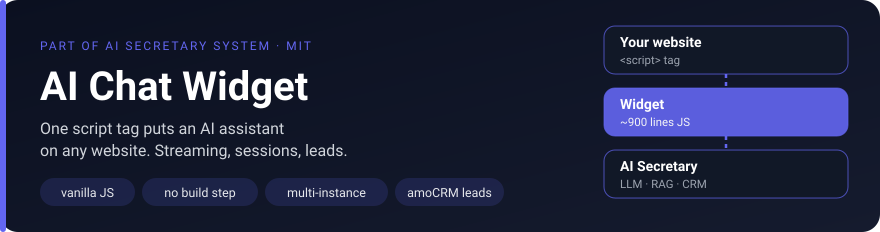

# AI Chat Widget

[](LICENSE)
[](ai-chat-widget.js)
[](https://github.com/ShaerWare/AI_Secretary_System)

An embeddable chat for any website: one `<script>` tag, no build step, no dependencies. Answers stream in as they are generated, the conversation survives page navigation, and a contact form turns a chat into a lead.

The widget is the website front end of [AI Secretary System](https://github.com/ShaerWare/AI_Secretary_System), an open-source self-hosted AI sales assistant. **It needs an AI Secretary backend**: that is where the model, prompt, knowledge base (RAG), FAQ, rate limits and CRM live, all configured per widget instance in the admin panel.

> **Mirror notice.** This repository is an automatic, read-only mirror of [`web-widget`](https://github.com/ShaerWare/AI_Secretary_System/tree/main/web-widget) in AI Secretary System. Stars are welcome here; please open issues and pull requests [in the main repository](https://github.com/ShaerWare/AI_Secretary_System/issues).

## Features

- **Streaming replies** over Server-Sent Events, rendered as they arrive.
- **Session persistence**: history is restored across page loads and navigations (cookie + `localStorage`, 30 days); the open/closed state is kept per tab.
- **Several widgets per backend**: each instance has its own model, prompt, voice, colours and allowed domains.
- **Lead capture**: an optional contact form after a few replies; contacts go to the backend and on to amoCRM.
- **Runtime switch**: a widget disabled in the admin panel hides itself on every site, with no code change.
- **Look**: primary colour, position, button size and offsets, six button icons, placeholder colour and font.
- Small JavaScript API: `window.aiChat.open()`, `.close()`, `.clearSession()`.

## Install

### Recommended: served by your AI Secretary

Create a widget in the admin panel (**Widget → New**), set its look, model and allowed domains, then paste the snippet it shows:

```html
<script src="https://your-ai-secretary.example.com/widget.js?instance=sales"></script>
```

The backend returns the script with that instance's settings already filled in. Omit `?instance=` to use the default widget.

### Self-hosted script

Host `ai-chat-widget.js` yourself (a CDN, GitHub Pages, your own server) and configure it inline:

```html
<script>
  window.aiChatSettings = {
    apiUrl: 'https://your-ai-secretary.example.com', // required
    instanceId: 'sales',
    title: 'AI Assistant',
    greeting: 'Hi! How can I help?',
    primaryColor: '#6366f1',
    position: 'right'
  };
</script>
<script src="/js/ai-chat-widget.js"></script>
```

The backend must be reachable over HTTPS from your visitors' browsers and list your site in the instance's allowed domains.

## Settings

| Setting | Default | Meaning |
|---|---|---|
| `apiUrl` | — | AI Secretary base URL, **required** |
| `instanceId` | `default` | Widget instance; also namespaces the session key |
| `title` | `AI Ассистент` | Chat window title |
| `greeting` | `Здравствуйте! Чем могу помочь?` | First message |
| `placeholder` | `Введите сообщение...` | Input placeholder |
| `primaryColor` | `#c2410c` | Button and accent colour |
| `placeholderColor`, `placeholderFont` | — | Input placeholder style |
| `buttonIcon` | `chat` | `chat`, `headset`, `robot`, `comment`, `support`, `wave` |
| `position` | `right` | `left` or `right` |
| `buttonSize` | `60` | Button size, px |
| `buttonOffsetBottom`, `buttonOffsetSide` | `20` | Button offsets, px |
| `sessionKey` | `ai_chat_session` | Storage key (set automatically from `instanceId`) |

When the script is served by the backend, these values come from the instance settings in the admin panel.

## Loading after cookie consent

```javascript
function loadAIChat() {
  if (document.getElementById('ai-chat-script')) return;
  const s = document.createElement('script');
  s.id = 'ai-chat-script';
  s.src = 'https://your-ai-secretary.example.com/widget.js?instance=sales';
  document.body.appendChild(s);
}
if (localStorage.getItem('cookieConsent') === 'accepted') loadAIChat();
```

## Troubleshooting

- **Nothing appears**: open the browser console. `// Widget is disabled` or `// Widget not allowed for domain` in the loaded script means the instance is off or your domain is not in its allowed list.
- **CORS errors**: the backend must be on HTTPS and reachable from the visitor's browser; for local testing, a tunnel such as `cloudflared tunnel --url http://localhost:8002` works.
- **Old conversation keeps coming back**: call `window.aiChat.clearSession()`.

## License

[MIT](LICENSE)
